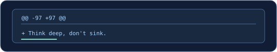

# hx

Run a coding agent in a fresh local Git clone, verify its work, and inspect the patch before choosing whether to apply it. hx records the command exits, changed files, and patch digest.

## Quick start

Requires Python 3.12+, Git and [uv](https://docs.astral.sh/uv/). From this repository:

```sh
uv run --locked hx demo
```

Without cloning, `uvx --from git+https://github.com/SkT97/hx hx demo` runs the current main branch.

The offline demo creates a disposable Git fixture, blocks an agent that only claims success, verifies a real fix and explicitly applies it to that fixture. It uses a deterministic fake agent; no model, API key or existing repository is involved.

<picture>
  <source media="(prefers-color-scheme: dark)" srcset="assets/wave.svg">
  
</picture>

## How it works

<picture>
  <source media="(prefers-color-scheme: dark)" srcset="assets/workflow.svg">
  
</picture>

A failed verifier blocks acceptance. hx compares the Git patch before and after verification. If the verifier changes it, the run remains inspectable and accept is blocked. Ignored build output is fine.

Review the verified patch before applying it. Both Git apply calls use the same digest-checked bytes. To accept a run recorded by an older version, rerun verification with this version. Git clone isolation does not sandbox the agent.

`hx check RUN` recomputes the patch digest, the status implied by the recorded exits and the file list implied by the patch. `hx attest RUN` prints an unsigned [in-toto](https://github.com/in-toto/attestation/blob/main/spec/v1/statement.md) statement for a run that passes. See [attestation](docs/attestation.md).

`hx run REPO --preflight -- ...` checks a run without starting it, and `hx run --json` prints a versioned result. Exit codes, statuses and the schema are in [result](docs/result.md).

<details>
<summary>Run your own agent and review a patch</summary>

```sh
uv run --locked hx run /path/to/repo --timeout 900 -- my-agent "fix the failing test" -- python -m pytest -q
uv run --locked hx inspect RUN_ID --json
uv run --locked hx diff RUN_ID
uv run --locked hx accept RUN_ID --yes
```

The two `--` separators delimit argument vectors. Commands are executed without a shell. The source must be clean and the run directory must be outside it. Pass an environment variable deliberately with `--pass-env NAME`; the default environment is allowlisted, with private HOME and temporary directories.

`accept` refuses failed or timed-out verification, an empty or modified patch, a patch that touches a path outside the recorded changed files or inside `.git`, a changed source HEAD, a dirty target, and a git older than 2.32. It applies an uncommitted patch; you own staging, commits and publication.

</details>

<picture>
  <source media="(prefers-color-scheme: dark)" srcset="assets/wave.svg">
  
</picture>

## Verification

The recorded local suite covers failed verification, timeouts, changed source HEAD, and patch integrity. See [verification](docs/verification.md).

<details>
<summary>Local verification and implementation choices</summary>

Checked locally on Windows, 18 November 2026. The 49 tests cover patch changes during verification, legacy run records, bounded output capture, timeout cleanup and source integrity. See [verification](docs/verification.md) for commands and limits.

The demo is a correctness check of the delegation loop. It is not a coding-model benchmark or a claim of improved task success.

- Fresh clones use `--no-hardlinks` to avoid sharing the source object files. Push is disabled in clone configuration. See [Git clone](https://git-scm.com/docs/git-clone).
- Argument vectors, explicit environments and process lifetimes follow the [Python subprocess API](https://docs.python.org/3.12/library/subprocess.html).
- Windows cleanup uses a suspended process assigned to a [Job Object](https://learn.microsoft.com/en-us/windows/win32/procthread/job-objects). POSIX cleanup targets a new process group.
- Runtime code uses the standard library; `uv.lock` pins development tooling. CI is configured to run tests, lint and the offline demo on Linux and Windows.

Sources reviewed 16 November 2026. These are design references, not external certification.

</details>

<details>
<summary>Development checks</summary>

```sh
uv sync --locked --group dev
uv run --locked python -m unittest discover -s tests -t .
uv run --locked ruff check .
uv run --locked ruff format --check .
```

</details>

## Limits

Git isolation is **not an OS security boundary**. An agent running as you can access your files and network, change its clone configuration, or tamper with a verifier. Use an OS/container boundary and a trusted external verifier for untrusted agents.

On POSIX, a descendant that creates a new session can leave the tracked process group. Both subprocess streams are drained concurrently, with only a bounded tail kept in memory and in the record. Known forwarded values are masked; this is not a general secret detector, and the patch may contain sensitive content. Inspect and scan artifacts before sharing them.

A digest detects accidental patch changes relative to the local record; someone who can change both can replace both. Acceptance is a local workflow guard, not a signed attestation or concurrent-writer transaction.

<details>
<summary>A patch in the margins · 97</summary>

<picture>
  <source media="(prefers-color-scheme: dark)" srcset="assets/side-quest.svg">
  
</picture>

</details>

## License

[Apache-2.0](LICENSE).
